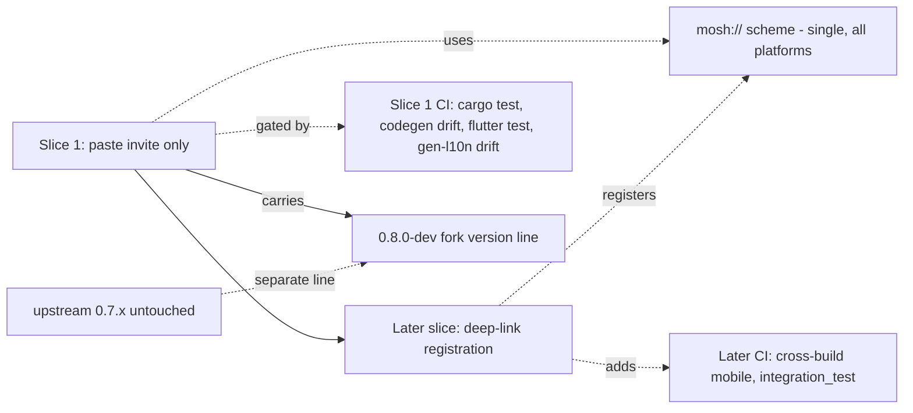

# ADR 0015: Deep-link phasing, scheme, minimal CI, version line

## Status

Accepted (slice two complete)

## Slice two outcome

Slice two (deep-link `mosh://` desktop) shipped and is closed:

- **Route shell:** `go_router` with `/`, `/join`, `/diagnostics`,
  `/dm/:id`; `MoshApp` is `MaterialApp.router`. The slice-one screens are
  now reachable (commit 5be0817).
- **Windows registration:** the `mosh://` scheme is registered under
  `HKCU\Software\Classes\mosh` via the `win32_registry` 3.0.3 Dart package
  (`lib/src/deeplink/mosh_url_scheme_windows.dart`): `URL Protocol` +
  `shell\open\command = "<resolvedExecutable>" "%1"`. HKCU needs no admin
  elevation for a dev build; idempotent; never throws (commit 9d30796).
- **Intake:** `windows/runner/main.cpp` calls `SendAppLinkToInstance()`
  (app_links 7.2.1 Windows C API) at the top of `wWinMain` so a second
  instance forwards the URI to the already-running one. Dart
  `lib/src/deeplink/mosh_deep_link.dart` subscribes
  `AppLinks().uriLinkStream`, gates scheme `== 'mosh'`, and navigates
  `appRouter.go('/join', extra: <uri>)`; a cold-start link is replayed on
  first frame (commit 4af9a27).
- **Single scheme** `mosh://` everywhere; no per-fork variant.
- **Mobile deferred:** Android `intent-filter` and iOS
  `CFBundleURLSchemes` remain a later slice (the mobile Moss cross-build
  + secure-storage platform channels slice). The Dart intake seam
  (`uriLinkStream`) is platform-agnostic, so mobile only needs the OS
  registration, not a new intake.

Tests: 48 Dart (was 42), `cargo test` 215/0/5-ignored (serial), `flutter
analyze` clean.

## Context

Grilling round 4 settled four mechanical questions:
1. Deep-link `mosh://` association is NOT in slice one; manual paste of the
   invite URI is. But deep-link must not be forgotten (user: "ne zabudem pro
   deeplink").
2. The `mosh://` scheme stays single and identical across all platforms
   (user confirmed Q15). No `mosh-flutter://` during the fork.
3. CI starts minimal and grows by platform (user confirmed Q16).
4. Version line for the fork is `0.8.0-dev` (user confirmed Q17), separate
   from upstream `0.7.x`, so the post-Tauri line is visible and the upstream
   merge later is a minor bump.

The current Tauri app registers `mosh://` via OS associations and parses the
URI from launch args/events. In Flutter this maps to `app_links` (mobile) +
desktop launch-arg handling in `main()`, but registration differs per
platform (Android intent-filter, iOS `CFBundleURLSchemes`, Linux `.desktop`,
Windows registry).

## Decision

Deep-link phasing:
- Slice one supports only manual paste of the invite URI into the "Join via
  invite" field. This matches the existing Tauri fallback path and is enough
  to prove the bridge and the invite-flow UI.
- Deep-link association (`mosh://` opens the app and pre-fills the invite
  field) is planned as an explicit later slice, not silently dropped. This
  ADR is the reminder.

Scheme:
- Single scheme `mosh://` everywhere. Android: `intent-filter` with
  `android:scheme="mosh"`. iOS: `CFBundleURLSchemes` = `["mosh"]`. Desktop:
  OS association + launch-arg parsing. No per-fork scheme variant.
- Bundle/application id is `app.mosh` on mobile (Q12) and `app.mosh.desktop`
  service name on desktop (ADR 0009). The scheme `mosh://` is owned by this
  bundle id, so there is no collision with any prior mobile release (none
  exists).

Minimal CI (slice one):
- Build `mosh-core` (desktop targets only for slice one) and run `cargo test`.
- Run `flutter_rust_bridge_codegen` to regenerate bindings; CI fails if the
  committed bindings drift from the Rust signatures.
- Run `flutter test` (unit + widget). With the slice-one fake gateway (ADR
  0013), widget tests run without the Rust runtime; a separate CI job runs
  the real-bridge integration tests at slice close-out.
- Run `flutter gen-l10n` and fail if ARB/generated `AppLocalizations` drift.
- Cross-compilation for Android/iOS and `flutter integration_test` are NOT in
  slice-one CI; they are added when those platforms are approached, each as
  an explicit step.

Version line:
- `mosh-flutter` starts at `0.8.0-dev`. `mosh-core` in the fork tracks the
  same version. Upstream `mosh` stays on its `0.7.x` line.
- The Moss release pin is the `moss/` submodule pointer (ADR 0002); the
  `moss.config.json` file the fork inherited was stale and is removed — the
  submodule is the one canonical pin.

## Boundaries

## Consequences

- Slice one stays focused on bridge + UI + i18n; deep-link is a planned,
  visible later slice, not lost work.
- One scheme `mosh://` means no future migration of invite URIs; existing
  invite URIs keep working across the upstream/fork boundary.
- Minimal CI catches the highest-drift risks (bindings, l10n, tests) from
  day one without the cost of cross-compiling for platforms that slice one
  does not target.
- `0.8.0-dev` makes the post-Tauri line unambiguous in version strings and
  diagnostics; when the fork merges upstream, upstream takes it as a minor.
- Moss pin inheritance means slice one does NOT silently advance the Moss
  release; any bump is deliberate and recorded.
## Alternatives considered

- Deep-link in slice one: rejected by the grilling recommendation; platform
  registration across 6 targets is its own slice and not needed to prove the
  bridge.
- Per-fork `mosh-flutter://` scheme: rejected by the user; would force an
  invite-URI migration later.
- Full CI from commit one: rejected by the user; mobile cross-build and
  integration tests belong with the platforms that need them.
- Resetting version to `0.0.1` in the fork: rejected; loses the continuity
  with `mosh-core` 0.7.x and confuses diagnostics.
## Open questions

- None blocking for slice one.
## Follow-ups

- Plan file must include "deep-link association" as an explicit future-slice
  item, not a buried note.
- Plan file must include the slice-one CI matrix as the ordered final
  validation step.
## References

- ADR 0009 (scheme + bundle id preservation)
- ADR 0013 (fake gateway for slice one tests)
- ADR 0014 (i18n, shares the gen-l10n CI drift check)

## Update 2026-09-02: CI consolidated, release workflow added

- Toolchains, caches and the moss build moved into `.github/actions/setup`;
  every job pins the same Go, Rust and Flutter versions from one place.
- `gen-l10n` runs inside the `flutter-test` job instead of a job of its own.
- The Windows installer is built by the reusable `build-windows.yml`, called
  both by CI on main and by `release.yml`, which a pushed `v*` tag triggers:
  it verifies the tag against `pubspec.yaml` and `CHANGELOG.md`, then publishes
  the installer, its SHA-256 and notes from `scripts/release-notes.sh`.
- Release builds of `mosh-core` use fat LTO, one codegen unit and stripped
  symbols; moss is built with `-trimpath -ldflags="-s -w"`.

## Update 2026-09-29: isolated discovery for native checks

The Windows and macOS Cargo jobs use `node scripts/moss-test.mjs`. The wrapper
starts WebTorrent's `bittorrent-tracker` 11.2.3 HTTP server on a random loopback
port, runs the requested Cargo tests and closes the server. It installs the
pinned test tool outside application manifests and the working tree.
The server's public filter hook accepts Moss's literal `event=none` as a
regular announce. Moss sources remain unchanged.

The Windows native Devices UI step uses the same wrapper with `--native-ui`.
It runs Flutter and its independent native peer under one real tracker, then
closes the tracker. Windows launches Flutter's batch entry point through a
fixed command; caller arguments are never interpolated into that command.

Native device linking runs in an independent Windows job. It builds the Rust
library and independent peer for `flutter_tester`, runs the real-process suites
and then exercises the Devices UI. It does not require a desktop app build or
wait for the Rust, binding and Flutter jobs. Desktop slice-one integration
retains those prerequisites and its Windows debug build. Cargokit cache
restore and save are separate: save follows the successful debug build, so a
later test failure cannot discard the cache. Shared Cargo dependency caches
can be saved by main and PRs from this repository, excluding fork PRs.

The Rust independent-peer fixture returns failed setup dials to its parent
instead of panicking in the child. Only Moss's `MOSS_ERR_CONNECT_FAILED` is
retried, within the existing observation deadline and with a pause between
attempts. Other failures stop immediately; persistent dial failures still fail
the scenario. Delivery and authenticated-session assertions remain unchanged.

The core test profile optimizes `curve25519-dalek`: unoptimized signature
arithmetic dominated real-Moss polling and exhausted the history deadline.
The fixtures retain real signature verification and their normal deadlines.

The Dart test peer keeps stdout draining between commands. A filtered
broadcast stream discards logs and buffers only JSON replies for the existing
iterator; iterator cancellation cancels the upstream subscription. A real
subprocess pipe regression verifies progress without a pending request and
the existing EOF error. This changes the test helper, not Moss transport.

Debug builds accept `MOSH_TEST_TRACKER_URL` only for
`http://127.0.0.1:<port>/announce`, without credentials, query or fragment.
This uses the SDK's existing `trackers` and isolated `network_id` options.
The Rust process fixture passes a random `MOSH_TEST_NETWORK_SCOPE` to every
installation in a scenario and retains it across restart. Each scenario gets
a separate network id, so tracker addresses from previous tests cannot affect
its discovery. The scope is a u64 and has no effect without the test tracker.
Public DHT, LAN discovery and NAT port mapping are disabled in that test
network. The peers retain real Moss transport, stream handlers, OpenMLS and
independent encrypted stores. Public bridge tests still discover each other
automatically and have no manual peer-address connection.

The test override is absent from release builds. With no override, debug
configuration remains byte-identical to the default configuration. Direct
Cargo and Flutter commands still probe the live public network, including its tracker
and relay availability. Public-network probes and physical-device acceptance
remain separate from the isolated CI proof. Test assertions, deadlines and
protocol retry budgets are unchanged.

## Update 2026-09-29: CI wall-clock

The repository is public, so runner minutes are free and wall-clock is the
cost that matters. All CI jobs start at once; the platform builds no longer
wait for the cheap checks. `macos-preflight` is removed: `macos-dmg` builds
the same x86_64 slice, and `rust-core-macos` keeps the podspec syntax check.
`flutter-test` runs on Ubuntu. Native device linking no longer repeats the
Cargo process suites that `rust-core` already runs.

The cargokit target-dir caches never matched a real path, so every platform
build compiled all Rust dependencies. They now point at the plugin's actual
build dirs: `build/windows/x64/plugins/mosh_core/cargokit_build`,
`build/macos/**/mosh_core.build` (the pod's Xcode `TARGET_TEMP_DIR`) and
`build/mosh_core/build` (the plugin's Gradle build dir, newly cached).

## Update 2026-10-07: Windows Cargo critical path

On main, `rust-core` took about 25 minutes, 21 of them in Cargo test: about
4.5 minutes compiling, 3.7 in the library tests and 11.5 in the
`multi_device_dm_flow` binary alone. That binary runs real Moss
installations waiting on protocol timeouts, so it is wall-clock rather than
CPU. It now runs in its own `rust-core-dm-flow` job beside `rust-core`,
which runs every other test target.

The compile was mostly dependencies. `codegen-drift`, `rust-core` and
`native-device-linking` shared the `desktop` Cargo cache, and the first job
to finish saves it. That was `codegen-drift`, which builds no test profile,
so the cache restored as a full match and the test jobs still rebuilt every
dependency. `codegen-drift` now saves under `desktop-codegen`; the jobs that
build the test profile share `desktop`.

The release builds became the critical path. A warm cargokit cache still
rebuilt mosh-core whenever its sources changed, and with fat LTO at one
codegen unit that rebuild ran single-threaded for about 4 minutes locally
(about 7 on the Windows runner). Changing `lto` would rebuild every
dependency, so CI proof builds keep fat LTO and give mosh-core alone 16
codegen units through the Cargo config: about 1.5 minutes locally, with the
dependency cache intact. Pull requests and main pushes both build this way,
so their caches stay interchangeable; `release.yml` builds the published
artifacts with the profile as committed.

## Update 2026-10-14: Android native hook toolchain

The Android APK job prepares `irondash_engine_context`'s Rust toolchain after
`flutter pub get`, before Gradle runs its native asset hook. The helper resolves
the package through `.dart_tool/package_config.json` and lets Rustup read the
dependency's own `android/rust/rust-toolchain.toml`, including its targets.
It retries failed installations at most three times and fails the job if none
succeeds. Mosh's compiler pin and the APK's arm64 target are unchanged.

## Update 2026-10-14: DM offline observation

The real-process DM control test uses the harness's existing 90-second
observation budget to establish that a stopped contact is offline before
testing sibling controls. Windows diagnostic runs measured polls up to 10.9
seconds; the failed main run logged a liveness transition after 36.2 seconds
of silence, beyond the test's previous 35-second deadline. A delayed captured
snapshot reproduced that failure despite the runtime transitioning offline.

The deterministic reachability test pins the contract independently of the
runtime constant: after a fresh authenticated message it requires Connected
at 24,999 ms and Handshaking at 25,000 ms, then verifies recovery on a new
message. Extending the runtime window to 60 seconds passed the previous
tests but fails this check. The real-process test still requires cleared typing
and checks that sibling typing and read controls preserve the contact's offline
state, display name and Moss identity.

The typing prerequisite refreshes the contact's signal while waiting for each
desktop, matching continued input. A single five-second hint can expire between
slow polls; a six-second gap between observers reproduced the CI failure with
the old prerequisite and passed with refreshed input. Both observation steps
reuse the harness budget; protocol deadlines are unchanged.

## Update 2026-10-15: Windows command replies

Real-process peer commands use the same 90-second observation budget as test
phases. The previous 30-second reply timeout could abort `dm_send` or `dm_poll`
while the worker was still alive, before the surrounding phase deadline.
Timeout diagnostics include the command budget and child-process status.
The real-process regression delays one reply for 35 seconds: it fails with the
old timeout and passes with the shared budget. The deterministic 25-second
silence-boundary test remains independent of this harness budget.

Bounded polling passes its outer deadline to each peer command. Each receive
uses the remaining time (capped by the command budget), and replies received
after that deadline fail before a caller can accept their state. A separate
real-process regression rejects a successful DM reply delayed for 35 seconds
when the caller's live-delivery budget is 30 seconds.

## Update 2026-10-15: Windows dependency caches

Windows jobs cache the Flutter SDK and existing Cargo/cargokit outputs, but
fetch pub dependencies without caching that directory. Main CI built and
uploaded the installer successfully, then spent 17 minutes archiving pub cache
and reached the 60-minute job limit during SDK cache cleanup. `flutter pub get`
took about one minute in that run; omitting the pub archive avoids that measured
cleanup cost without changing build inputs or the job timeout.

## Update 2026-11-06: cache budget (MOSH-80)

The repository has 10 GB of Actions cache, and GitHub evicts the least
recently used entries above it. A single run saved more than that: PR #124's
run filled the cache and evicted every main entry. Entries saved on a pull
request ref are visible to no other ref, so the next main run and every other
pull request rebuilt from nothing.

Caches are now saved only from main; every other ref restores them. Plain
caches are `actions/cache/restore` and `actions/cache/save` pairs with the
save on main. `Swatinem/rust-cache` saves on main only, which replaces the
same-repository PR saves above.

Main's own set was about 16 GB, so it would still evict itself. Only jobs on
the critical path keep build caches: the desktop, Android and macOS app
builds and the Rust core jobs. Removed:

- the Flutter SDK (1.6-1.8 GB per OS). Installing it takes 50-95 seconds,
  and restoring it hardly less. The Linux pub cache stays.
- the Cargo and engine target caches of the call-engine jobs (about 6 GB).
  They take 11-17 minutes cold, against a critical path of about 28 minutes
  on pull requests and 43 on main.
- the license, widget-test hook and network-diagnostics caches, and the Go
  module cache: setup-go cannot make it read-only, and the moss library
  cache skips the Go build everywhere but the license job.

`taiki-e/cache-cargo-install-action` still saves from any ref, but only
when its pinned tool version misses, a few megabytes per version bump.

When a key's hash changes, main saves a new entry and nothing reads the old
one again. [cache-cleanup.yml](../../.github/workflows/cache-cleanup.yml)
runs after CI on main and deletes every main entry that a newer entry of the
same key, its trailing hashes aside, has replaced. It warns when the
repository's caches exceed 8 GB, the budget main's set is meant to stay under.

Without their caches the call-engine jobs download the libwebrtc build,
pinned sources and protoc on every run. These downloads now go through one
checksummed downloader that retries dropped, truncated and 5xx responses.

The first main run with this set saved 9.9 GB, over budget: the universal
macOS cargokit build alone is 2.5 GB, and the Gradle home another 2.5 GB.
The macOS entry stays, since it takes the DMG job from 42 to 13 minutes on
the critical path. The Gradle home cache is gone (it had moved to
`gradle/actions/setup-gradle` for its read-only mode): in that run every
Android job missed it after a build-file change, and the signed release APKs
still finished in 15 minutes, against a 28-minute critical path. Main's set
is then about 7.5 GB.

Linux system packages go through `.github/actions/apt-install`: no
recommends, and the downloaded `.deb` files cached on main per job, keyed by
the resolved package versions. On runs where the Azure Ubuntu mirror served
40 kB/s, the libwebrtc job's 73 MB of packages took 30 minutes instead of 2.
29 MB of that was `libclang-18-dev`, which is gone: bindgen loads the
libclang 18 that the runner image already ships. The rest is about 38 MB, so
an uncached run on a slow mirror still takes about 15 minutes.

## Update 2026-11-11: what the real-process suites wait for (MOSH-103)

`rust-core-dm-flow` failed twice in 25 runs on main with a peer silent for 23
to 45 seconds on one `dm_poll`. In both logs every peer slowed down for about
three minutes, starting in a scenario that sends 40 messages. The 2026-10-14
and 2026-10-15 updates above met slow polls and replies too and raised
budgets. Two runs of twenty jobs on Windows runners, with probes in the test
process and in the peers, reproduced the slowdown at a smaller scale and
showed what it is:

- The runner's processor was idle throughout. A synced 4 KiB write to the
  system temp directory (`C:`) took 15 to 44 ms on average and up to 2.9
  seconds, for minutes at a time. The same write to the runner's work drive
  (`D:`, `runner.temp`) took under a millisecond in the same seconds.
- An installation commits to its store about 14 times for every message it
  receives, each commit a synced write, inside the runtime's lock. In the
  scenarios that send 40 messages a `dm_send` took up to 15.6 seconds and a
  service tick up to 7.8, and a poll waits for the same lock.

The Cargo test steps of `rust-core` and `rust-core-dm-flow` now set `TMP` and
`TEMP` to `runner.temp`. The number of commits per message is a product
matter of its own (MOSH-104).

Scenarios also ran one at a time, behind a lock from before each had its own
discovery network. Under the local tracker they now run side by side. The two
harness tests that sleep 35 seconds hold no scenario. The harness prints each
scenario's time, a peer's steps that take seconds and a stalled disk or
scheduler ([test policy](../testing.md)).

| `multi_device_dm_flow`, 23 tests | Test time |
| --- | --- |
| Before, Windows runner | 424 s (560 and 668 s in the failed runs) |
| One at a time, slow-reply tests beside, 10 runs | 329 to 401 s |
| Side by side, stores on `C:`, 20 runs | 115 to 142 s |
| Side by side, stores on `D:`, 10 runs | 95 to 108 s |

All 40 jobs passed. With the stores on `D:` the longest scenario took 37 to
40 seconds, what it takes alone, and no step of a peer took 2 seconds.

A third run of twenty jobs with the job's final steps passed twenty times in
a row, in 96 to 108 seconds. The other suites run side by side too: the test
step of `rust-core` passed ten times with 216 to 309 seconds of tests against
416 before, and that of `rust-core-macos` three times with 438 to 474 against
754.

`rust-core-macos` still runs the multi-device DM flow: it is the suite's only
run on a Unix network stack and file system, and the job is not on the
critical path. `device_link_flow` runs in `rust-core` and `rust-core-macos`
for the same reason. The `native-call-media` jobs run only its ignored
`native_` tests, one at a time: their encoders were not measured side by
side.

## Update 2026-11-12: the app builds on the critical path (MOSH-105)

With the Rust suites side by side, a pull request took 22 minutes and four
app builds set that: the macOS DMG 22 minutes, the Windows MSIX and installer
20 each, the integration test 18. Their caches hit, and the repository's
cache stood at 9.4 of 10 GB, so the builds themselves had to get shorter.
Builds with `flutter build -v` showed where the time went.

**Windows.** `flutter build windows` runs MSBuild with one project at a time
and cl with one file at a time. On a four-core runner the 921 seconds of a
release build were a queue:

| Stage | Time |
| --- | --- |
| CMake configure, fetching sentry-native | 58 s |
| mosh-core, cache warm | 202 s |
| Call engine and camera helper, built cold | 277 s |
| Dart AOT and native asset hooks | 119 s |
| C++: plugins, sentry-native with crashpad, the runner | 258 s |

The setup action now sets `CMAKE_BUILD_PARALLEL_LEVEL` and `CL=-MP` in the
Windows jobs that install Flutter. mosh-core and the call engine build side
by side and the C++ uses every core: over five builds the release app took
573 to 770 seconds against 884 to 933, and over three the debug app of the
integration test 565 to 572 against 724 to 766. Project-level parallelism
alone gave 812. MSBuild still starts the Dart compile and the C++ only after
both Rust builds. The compiler option is written with a dash: Git Bash
rewrites `/MP` into a path when it starts a Windows program.

**macOS.** The pull request DMG was meant to build arm64 alone through
`ONLY_ACTIVE_ARCH`. A release build's destination is generic and has no
active architecture, so the setting never took effect: the packaging step
listed `x86_64 arm64` for every binary. `build-macos.yml` now excludes
x86_64 through Flutter's `FLUTTER_XCODE_*` build settings, which reach the
pods and their scripts, and the packaging step lists arm64. Between two
verbose builds every phase halved: mosh-core 421 to 177 seconds, the Dart
compile 142 to 77, the call engine 198 to 79, the whole build 992 to 510.
Runner speed moves the totals as much: three arm64 builds took 510 to 703
seconds, and three universal ones 547 to 992.

After that build the job ran the runner's six tests, which are hosted in the
Debug app and so build it whole: 213 to 550 seconds more in the longest job
of a pull request. As a fourth macOS job of the run they took 15 minutes and
made another wait 8 to 14 minutes for a runner: three macOS jobs ran at a
time. They are now
[macos-runner-tests.yml](../../.github/workflows/macos-runner-tests.yml),
which runs on a change under `macos/` and by hand. The DMG job compiles the
same Swift sources on every pull request.

**Cargo caches.** The first job of a cache namespace to finish saves its
key, as with `codegen-drift` in the 2026-10-07 update. For `desktop` that was
`native-device-linking`, which runs no clippy, so `rust-core` checked all 332
dependencies again on every run: 132 seconds. Saving is now an input of the
setup action, off unless a job asks: `rust-core`, `rust-core-macos` and
`codegen-drift` save what they build, and one job each saves the downloaded
crates of the Windows and Android app builds. The call UI workflow restores
the Rust core caches; it used to save a 622 MB macOS entry nothing else read.

**Go and Moss.** Only the Moss builds and the license check run Go. A
desktop job that restores its library installs none, 20 seconds on a Windows
runner. The Android jobs built `libmoss.so` in the setup and cached it, then
Gradle built it again on every run, since a fresh checkout has no Gradle
history to call the task up to date. The setup's build and its cache are
gone.

Two runs of every job as a pull request runs them passed. The second, with
three macOS jobs, took 18.6 minutes against 22; its longest job was the
Windows installer at 18.5 minutes, and at 16.5 in the first. Runner speed
moves these by minutes from run to run.

Left alone: a call engine cache for the Windows app builds, about two minutes
for a cache the budget has no room for; fat LTO in the proof builds, as
decided on 2026-10-07; the Flutter SDK and pub downloads on Windows, about
2.5 minutes a job, whose caches were slower than the downloads; the voice
check of the Linux call media job, which in the run read spent 5.9 of its
6.5 minutes building its bench in release; and the universal DMG of main,
whose build took 38 minutes in the run after `Cargo.lock` changed and its
cargokit cache missed, and 9 with the cache warm.
